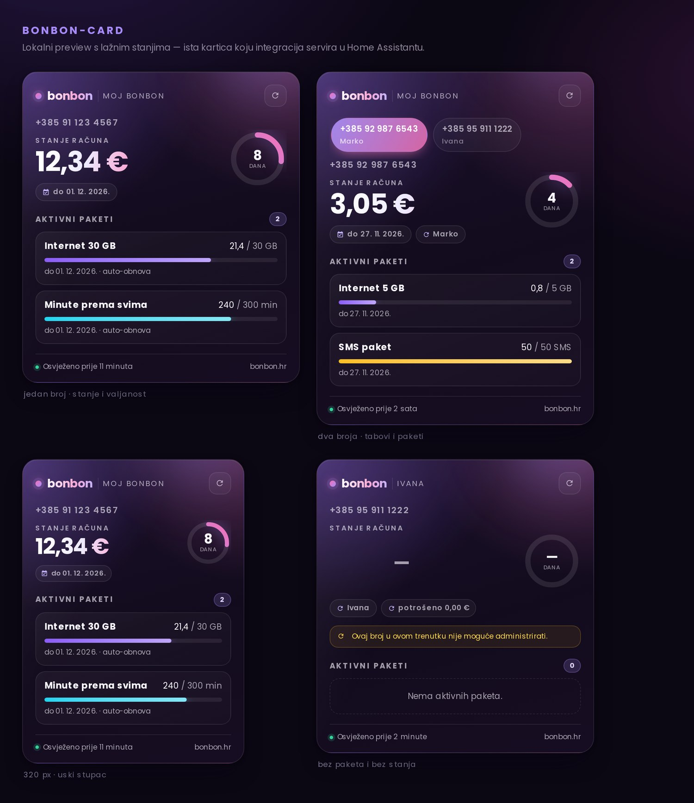

# bonbon za Home Assistant

Neformalna integracija koja u Home Assistant dovlači ono što inače gledaš na
**Moj bonbon** portalu: broj, aktivne pakete, stanje računa i datum valjanosti —
plus Lovelace karticu koja to izgleda kao da joj je mjesto u aplikaciji, a ne u
YAMLu.

> Nije povezano s bonbon d.o.o. ni Hrvatskim Telekomom. Koristi vlastitu,
> prijavljenu sesiju tvojeg računa — ništa se ne šalje nigdje osim na
> `bonbon.hr`.

## Što dobiješ

- **Više brojeva na jednom računu** — svaki broj je zaseban uređaj sa svojim
  entitetima, a kartica ih prikazuje s tabovima.
- **Stanje računa** kao monetary senzor (EUR), **valjanost** kao datum, plus
  brojač dana do isteka.
- **Aktivni paketi** s preostalim količinama (GB / minute / SMS), potrošnjom,
  datumom isteka i auto-obnovom.
- **Osvježavanje svaka 3 sata** (podesivo 1–24 h) i tiha obnova sesije u
  pozadini, tako da prijava ne puca svako malo.
- **Kartica `custom:bonbon-card`** — dolazi s integracijom, automatski se
  registrira kao frontend resurs, ništa ne instaliraš zasebno.

## Zahtjevi

| | |
|---|---|
| Home Assistant | **2026.11** ili noviji |
| Instalacija | HACS (custom repository) ili ručno iz release zipa |
| Račun | bonbon broj vidljiv na [Moj bonbon](https://www.bonbon.hr) portalu |

## Instalacija

### HACS (preporučeno)

1. HACS → tri točke → **Custom repositories**
2. URL: `https://github.com/ngarafol/mojbonboninfo`, kategorija **Integration**
3. Instaliraj **Bonbon**, pa restartaj Home Assistant
4. **Settings → Devices & services → Add integration → Bonbon**

### Ručno

1. Skini `bonbon.zip` sa [zadnjeg releasea](https://github.com/ngarafol/mojbonboninfo/releases)
2. Raspakiraj **u mapu integracije**:

   ```bash
   mkdir -p /config/custom_components/bonbon
   unzip bonbon.zip -d /config/custom_components/bonbon
   ```

3. Restartaj Home Assistant

Zip ima `manifest.json` u korijenu jer HACS raspakirava asset točno u
`custom_components/bonbon` — provjeri da si dobio
`/config/custom_components/bonbon/manifest.json` (ne još jedan
`custom_components` unutra).

## Postavljanje

bonbon prijava ide preko Hrvatskog Telekoma (Google, Apple, ...), što znači da
integracija **ne može** sama odraditi login — nema lozinke koju bi ponovila, a
OAuth klijent portala je povjerljiv i odbija izmjenu autorizacijskog koda bez
tajne. Zato Home Assistant preuzima sesiju koju tvoj preglednik već ima. Traje
oko 15 sekundi:

1. Prijavi se na <https://www.bonbon.hr> u pregledniku i otvori **Moj bonbon**.
2. Otvori Developer tools (**F12**) → kartica **Network**, u filter upiši `api4`.
3. Pojavit će se zahtjevi na `api4.bonbon.hr` (to je API portala).
4. Desni klik na bilo koji od njih → **Copy** → **Copy as cURL**.
5. U Home Assistantu: **Add integration → Bonbon**, zalijepi u polje i potvrdi.

> Važno: kopiraj zahtjev s **api4.bonbon.hr**, ne s `www.bonbon.hr` — tamo su
> drugi kolačići i API bi ih odbio.

Integracija odmah provjeri sesiju: ako vidi brojeve, sprema je i kreće s
pollingom. Ako ne vidi, javit će `invalid_auth` i možeš zalijepiti svježi
zahtjev.

### Što se sprema

Sesija (cookieji i par headera) sprema se **lokalno** u
`/config/.storage/bonbon.<entry_id>` — nikad se ne šalje nigdje osim na
`bonbon.hr`. Dijagnostika nikad ne ispisuje vrijednosti cookieja, samo imena.

## Kartica



Dodaj karticu kroz UI (**Add card → Bonbon**) ili ručno:

```yaml
type: custom:bonbon-card
```

Kartica sama pronalazi sve brojeve. Ako imaš više računa, možeš je zaključati
na jedan:

```yaml
type: custom:bonbon-card
entry_id: 01J8Z6ZKZ8YQ2S8S8S8S8S8S8S   # ID config entryja
title: Markov bonbon                   # opcionalno, zamjenjuje naziv
```

| Opcija | Opis |
|---|---|
| `entry_id` | Prikaži samo brojeve jednog config entryja |
| `entity` | Prikaži samo broj iz jednog senzora (npr. `sensor.bonbon_385911111111_phone_number`) |
| `title` | Tekst uz `bonbon` u zaglavlju |

Kartica radi u obje teme, poštuje `prefers-reduced-motion`, ima tipkovnički
fokus na svim kontrolama i animira stanje/ringove pri svakom osvježavanju.
Izgled se može dotjerati CSS varijablama (`--bonbon-radius`, `--bonbon-text`,
`--bonbon-muted`, `--bonbon-line`) preko `card_mod` ili theme filea.

## Entiteti

Za svaki broj dobiješ uređaj (naziv = labela ili `bonbon +385...`) i ove senzore:

| Entitet | Stanje | Napomena |
|---|---|---|
| `sensor.bonbon_<broj>_phone_number` | `+385911111111` | nosi cijeli `bonbon` atribut za karticu |
| `sensor.bonbon_<broj>_account_balance` | `12.34` EUR | `device_class: monetary` |
| `sensor.bonbon_<broj>_valid_until` | `2026-12-01` | datum + atribut `days_left` |
| `sensor.bonbon_<broj>_active_packages` | broj aktivnih paketa | atribut `packages` s cijelim popisom |
| `sensor.bonbon_<broj>_data_left` | preostalo GB | samo ako broj ima data paket |
| `sensor.bonbon_<broj>_minutes_left` | preostalo minuta | samo ako ima minute |
| `sensor.bonbon_<broj>_sms_left` | preostalo SMS | samo ako ima SMS |

Entity ID-evi prate jezik Home Assistenta — na hrvatskom su npr.
`sensor.bonbon_385911111111_stanje_racuna` i `..._preostalo_podataka`, a ako
broj ima labelu (npr. „Marko"), prefiks je `sensor.marko_...`.

Senzori potrošnje zbrajaju sve pakete iste vrste (npr. dva data paketa → jedan
zbroj) i uz stanje nose `used`, `total` i `packages` atribute. Senzor stanja
nosi i `spending` (potrošeno) te `portal_message` — poruku kojom portal sam
objasni zašto za neki broj ne vraća podatke.

### Kad portal ne vraća podatke

bonbon portal za broj koji je istekao, nije registrovan ili je ugašen vraća
`status.success: 0` uz poruku tipa „Ovaj broj u ovom trenutku nije moguće
administrirati." To **nije** greška integracije: broj se i dalje prikazuje
(naziv, potrošnja, datum isteka iz popisa brojeva), a kartica umjesto stanja i
paketa pokaže tu poruku. Kad broj ponovno postane aktivan, podaci se pojave sami
nakon sljedećeg osvježavanja.

Primjer automatizacije — upozorenje kad ostane manje od 1 GB:

```yaml
automation:
  - alias: "bonbon — malo podataka"
    triggers:
      - trigger: numeric_state
        entity_id: sensor.bonbon_385911111111_data_left
        below: 1
    actions:
      - action: notify.mobile_app_moj_telefon
        data:
          message: "Ostalo je manje od 1 GB podataka."
```

## Osvježavanje i prijava

- Polling je **svaka 3 sata** (opcije: 1–24 h). Portal se ne mijenja često, a
  češći polling samo povećava šansu da te portal odbije.
- Kad API vrati 401/403, integracija prvo pokuša **tihu obnovu** u dva koraka:
  osvježi sesiju preko otvorene portala stranice (`/profil`), a ako ni to ne
  pomogne ponovi SSO handshake s `prompt=none` koristeći spremljene Keycloak
  cookieje. Ako uspije, nastavi bez ikakve intervencije.
- Ako tiha obnova ne uspije, Home Assistant prikaže **Reauthenticate** na
  integraciji — zalijepiš svježi cURL i sve radi dalje. Entiteti u međuvremenu
  postanu `unavailable`, ništa se ne briše.
- Rotirani cookieji se spremaju nakon svakog uspješnog polla, pa restart Home
  Assistenta ne traži novu prijavu.

> Napomena: tiha obnova radi samo ako su u zalijepljenom zahtjevu i cookieji
> `login.hrvatskitelekom.hr`. Ako kopiraš zahtjev s `www.bonbon.hr`, portal
> sesija se obnavlja dok god ju bonbon drži živom; kad istekne, slijedi
> reauth. To je i očekivano ponašanje.

## Rješavanje problema

| Simptom | Što probati |
|---|---|
| `invalid_auth` pri dodavanju | Kopiraj zahtjev s **Moj bonbon** stranice, ne s naslovnice; provjeri da si prijavljen. |
| `invalid_session` | Zalijepio si nešto što nije cURL ili nije s `bonbon.hr`. Ponovi korak 4. |
| Entiteti `unavailable` | Sesija je istekla → reauth. Provjeri i log: `custom_components.bonbon`. |
| Kartica ne postoji u pickeru | Restartaj HA nakon instalacije; provjeri da nema JS greške u konzoli. |
| Podaci su prazni | Pokreni `homeassistant.update_entity` na `sensor.bonbon_<broj>_phone_number` i pogledaj log. |

Debug log:

```yaml
logger:
  default: warning
  logs:
    custom_components.bonbon: debug
```

## Razvoj

```bash
python3 tests/run.py                     # parsiranje i cookieji, bez ovisnosti
ruff check custom_components tests

# integracijski testovi na pravom HA test harnessu (pytest)
pip install pytest-homeassistant-custom-component home-assistant-frontend
pytest -q                                # setup, reauth, config flow, entiteti
python scripts/build.py                  # bonbon.zip
```

Karticu možeš pregledati bez Home Assistenta: otvori `scripts/preview.html` u
browseru — unutra su lažna stanja (jedan broj, više brojeva, uski stupac, broj
koji portal odbija), pa se dizajn mijenja bez restarta HA.

Struktura:

```
custom_components/bonbon/
├── __init__.py          # setup, registracija kartice
├── api.py               # HTTP + tiha obnova sesije
├── config_flow.py       # dodavanje, reauth, opcije
├── const.py
├── coordinator.py       # polling + perzistencija sesije
├── cookies.py           # mali perzistentni cookie jar
├── models.py            # parsiranje portala (bez HA importa)
├── sensor.py
├── diagnostics.py
├── session_import.py    # "Copy as cURL" parser
├── frontend/bonbon-card.js
├── strings.json + translations/{en,hr}.json
└── manifest.json
```

`models.py`, `cookies.py` i `session_import.py` ne importaju Home Assistant —
to je dio koji pukne kad bonbon promijeni portal, pa se testira običnim
`assert`ovima.

## Release

Verzija živi u `manifest.json`. Release se izdaje tagom:

```bash
# 1. podigni "version" u custom_components/bonbon/manifest.json
# 2. commitaj
git tag v0.1.0
git push origin main --tags
```

GitHub Actions tada provjeri da se tag i `manifest.json` slažu, spakira
`custom_components/bonbon` u `bonbon.zip`, i napravi release s tim assetom.
HACS ga vidi kao update. Tagovi s nastavkom (npr. `v0.2.0-beta.1`) idu kao
prerelease.

## Licenca

[MIT](LICENSE)
